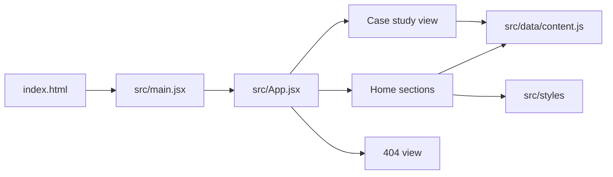

<div align="center">


# Mushtaq Ahmad

### AI Undergraduate · Frontend Developer · Builder of student-first tools

<p>
  A hand-crafted portfolio and public learning journal inspired by a technical lab notebook.
  Built to show the work, thinking, and experiments behind every project.
</p>

<p>
  <a href="https://github.com/MushtaqAhmadSaqi"></a>
  <a href="https://openprep.com.pk"></a>
  <a href="https://comsatsprephub.vercel.app"></a>
</p>

<p>
  <a href="#-what-is-inside">Explore the portfolio</a> ·
  <a href="#-run-it-locally">Run it locally</a> ·
  <a href="https://www.linkedin.com/in/mushtaqahmad12/">Connect on LinkedIn</a>
</p>

</div>

---

## ✦ What is inside

| Section | Purpose |
| --- | --- |
| **Hero** | A clear introduction, current sprint, and primary calls to action |
| **Selected Work** | Featured projects with metrics, architecture notes, and detailed case studies |
| **Lab Log** | A filterable timeline of learning, experiments, and shipped improvements |
| **Toolbox** | An honest, tiered view of technologies and working strengths |
| **About** | The story behind the work, from Skardu to Islamabad |
| **Contact** | A focused sign-off sheet with quick links and a Formspree-ready form |

### Highlights

- **12,100+** practice questions represented through the OpenPrep project
- **Live project case studies** with problem, approach, challenge, and lessons learned
- **Day Paper / Night Carbon** theme switch with persisted preference
- **Responsive notebook layout** with reduced-motion support
- **Hash-based case-study navigation** that works on static hosting
- **Asia/Karachi live clock** and small developer-friendly details throughout

## ✎ Design direction

The interface treats the browser like an open engineering notebook:

`paper surfaces` · `graphite panels` · `ink typography` · `vermilion annotations`

The visual system combines editorial headings, mono-spaced metadata, asymmetric ledger layouts,
hand-drawn SVG accents, animated counters, and subtle paper-lift interactions. It stays
deliberately lightweight: React, Vite, and plain CSS custom properties with no UI framework.

## ⚙️ Tech stack

<p>
  
  
  
  
  
</p>

## ◌ Architecture



Content is intentionally centralized in [`src/data/content.js`](./src/data/content.js).
That means projects, lab notes, links, metrics, and personal copy can be updated without
digging through presentation components.

## ◉ Run it locally

Requires [Node.js](https://nodejs.org/) 18 or newer.

```bash
git clone https://github.com/MushtaqAhmadSaqi/Portfolio.git
cd Portfolio
npm install
npm run dev
```

Open the local URL printed by Vite, usually `http://localhost:5173`.

To create and preview a production build:

```bash
npm run build
npm run preview
```

## ✍️ Make it yours

1. Open [`src/data/content.js`](./src/data/content.js).
2. Update `siteContent.meta` for identity, links, contact details, and CV.
3. Edit `siteContent.projects` to add or update project cards and case studies.
4. Prepend entries to `siteContent.labLog` for new learning notes.
5. Replace [`public/photo.jpeg`](./public/photo.jpeg) if you want to use a new portrait.
6. Replace the placeholder Formspree endpoint before enabling production contact submissions.

The components are already split by portfolio section, so visual changes can be made in
[`src/styles/notebook.css`](./src/styles/notebook.css) and [`src/styles/tokens.css`](./src/styles/tokens.css)
without changing content data.

## ▲ Deploy

### Vercel

Import the repository at [vercel.com/new](https://vercel.com/new). Vercel detects Vite
automatically and uses `npm run build` with `dist` as the output directory.

### Netlify

Set the build command to `npm run build` and the publish directory to `dist`.

### GitHub Pages

Build with `npm run build`, then publish `dist` through GitHub Pages or a GitHub Actions
workflow. The relative Vite base and [`public/404.html`](./public/404.html) support static
hosting and client-side routes.

## Contact

**Mushtaq Ahmad Saqi** · Islamabad, Pakistan
[Email](mailto:mushtaqahmedsaqi1234@gmail.com) ·
[LinkedIn](https://www.linkedin.com/in/mushtaqahmad12/) ·
[GitHub](https://github.com/MushtaqAhmadSaqi)

<div align="center">

<br />

_Built with curiosity, shipped with intent._

</div>
